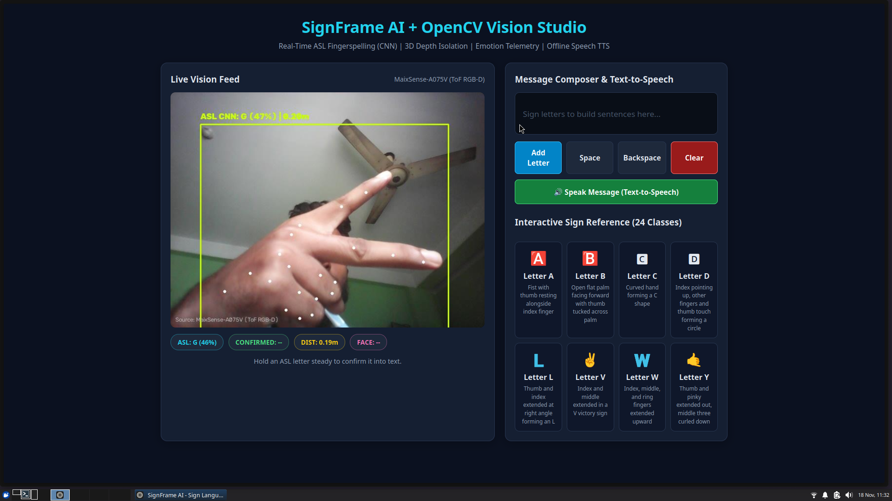
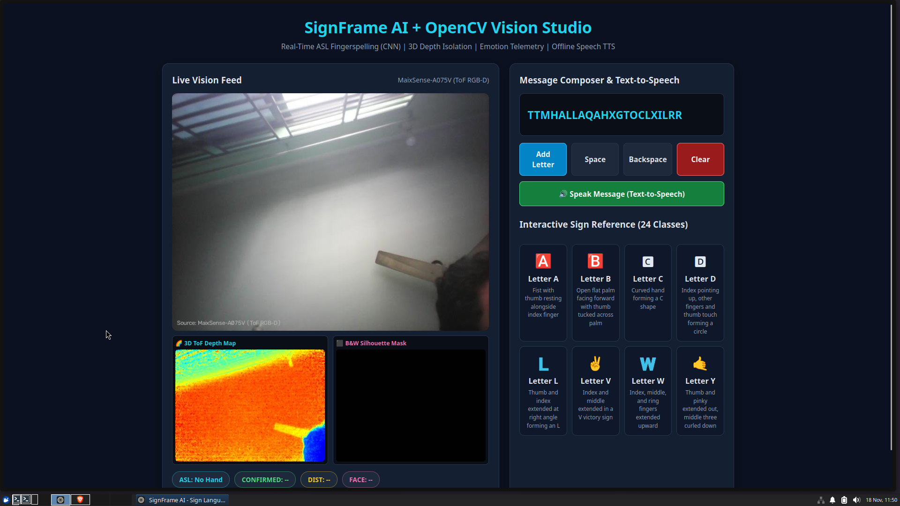

# OpenCV-Deaf & SignFrame AI Vision Suite

Unified Computer Vision & Deep Learning suite for American Sign Language (ASL) fingerspelling, 3D hand tracking, metric depth estimation, and expressive gesture communication. Designed for standard webcams and the **Sipeed MaixSense-A075V** RGB-D Time-of-Flight (ToF) camera module.


*Figure 1: Full-stack Sign Language Communication Studio running real-time ASL fingerspelling recognition, live ToF depth colormap, B&W silhouette segmentation, facial emotion telemetry, and assistive text composition.*

---

## 📸 System Demonstration & Hardware

| Web Vision Studio (Real-time Pipeline) | MaixSense-A075V Hardware & Camera Setup |
| :---: | :---: |
|  |  |
| *Live ASL CNN fingerspelling, emotion tracking, 3D ToF depth map, and B&W silhouette* | *Sipeed MaixSense-A075V RGB-D Time-of-Flight USB/Ethernet hardware rig* |

---

## 🌟 Core Features & Modules

### 1. SignFrame AI (ASL Fingerspelling & Speech)
- **24 Static ASL Letters:** Real-time fingerspelling recognition powered by a custom PyTorch CNN (`models/feedback_candidate.pth`).
- **Prediction Stabilization:** Temporal smoothing across frames before letter confirmation to prevent flickering (`src/stabilizer.py`).
- **Auto-Commit & Message Composer:** Automatically adds confirmed letters when held steady for ~0.8s, with interactive manual override, space, backspace, and clearing (`src/text_composer.py`).
- **Offline Text-to-Speech (TTS):** Vocalizes composed sentences through `pyttsx3` / eSpeak.
- **Run Webcam App:**
  ```bash
  python3 src/webcam_app.py
  ```

### 2. Multi-Modal Vision Pipelines (`sign_app/camera.py`)
- **Process 1: Facial Emotion Recognition:** YuNet face detector + ONNX FER+ classifier recognizing 8 universal facial expressions (*Happy, Sad, Angry, Surprised, Neutral, etc.*) at high FPS.
- **Process 2: MediaPipe 3D Landmark + PyTorch CNN:** 21 landmark 3D joint localization with CLAHE contrast enhancement feeding a normalized 28×28 grayscale hand patch to the CNN.
- **Process 3: 3D ToF Depth Foreground Contour Segmentation:** Fallback geometric convexity defect and solidity analyzer operating directly on the raw depth cloud (works even in pitch darkness or monochrome).
- **Process 4: Live Depth & B&W Auxiliary Visualizers:**
  - **3D Depth Map:** Jet-colormap depth visualization streaming from `/depth_feed`.
  - **B&W Silhouette Mask:** Real-time foreground hand isolation & thresholding streaming from `/mask_feed`.

### 3. MaixSense-A075V 3D ToF Vision Studios
- **3D Depth Foreground Isolation:** Locks onto hands in 3D millimeters (10 cm – 1.8 m), completely eliminating background bleed (walls, furniture, curtains).
- **Hugging Face SigLIP-2 Zero-Shot Recognition:** Flagship vision-language model (`google/siglip2-so400m-patch14-384`) classifying 14+ expressive gestures and 8 real-life facial emotions.
- **Multi-Hand 3D Engine:** Tracks 1 to 4 hands simultaneously using MediaPipe 21 3D landmarks with real-time metric distance telemetry.
- **FastAPI Web Teacher:** Interactive sign language learning web app with live camera feed and scoring.

---

## 🧠 Model Description & Architecture

### ASL Fingerspelling CNN (`models/feedback_candidate.pth`)
- **Input:** $1 \times 28 \times 28$ Grayscale hand ROI, contrast-normalized with CLAHE.
- **Architecture:** Multi-stage 2D Convolutional Neural Network with BatchNorm, ReLU, MaxPool, Dropout regularization, and Fully Connected dense heads.
- **Classes (24 letters):** A, B, C, D, E, F, G, H, I, K, L, M, N, O, P, Q, R, S, T, U, V, W, X, Y (J and Z excluded as dynamic signs).
- **Inference Latency:** ~2.1 ms on standard x86 CPU.

### Facial Emotion Recognition
- **Face Detection:** YuNet ONNX (640×640 dynamic shape).
- **Emotion Classification:** FER+ ONNX model classifying 8 expressions.

### Camera Hardware: Sipeed MaixSense-A075V
- **Sensor Type:** Time-of-Flight (ToF) + RGB CMOS Sensor.
- **Interface:** RNDIS USB virtual Ethernet (`192.168.233.1`), composite binary packet streaming with depth + IR + RGB frames over HTTP (`/getdeep`).
- **Depth Resolution:** 320×240 @ 30 FPS, millimeter precision (80 mm – 2500 mm).

---

## 🛠️ Everything We Tried & Lessons Learned

During the engineering and unification of OpenCV-Deaf with SignFrame AI, we tackled multiple technical challenges:

1. **Camera Network Auto-Configuration (udev & RNDIS):**
   - *Problem:* Linux udev renames the USB RNDIS interface on each reconnect (`enx*`), losing the static IP `192.168.233.100` needed to reach the A075V gateway (`192.168.233.1`).
   - *Solution:* Created `/usr/local/bin/setup-a075v-net.sh` and `/etc/udev/rules.d/99-a075v.rules` to detect hotplug events and assign the subnet automatically. Added graceful fallback to local webcam (`/dev/video0`) when disconnected.

2. **Lighting & Contrast Failures with MediaPipe:**
   - *Problem:* In low-light environments or monochrome webcam streams, standard MediaPipe HandLandmarker struggled to detect palms.
   - *Solution:* Introduced an adaptive CLAHE (Contrast Limited Adaptive Histogram Equalization) pre-pass in `enhance_contrast()`, doubling landmark detection consistency.

3. **Multi-Modal Ensemble (Depth Fallback when MediaPipe Fails):**
   - *Problem:* Hands positioned sideways or under extreme shadows caused 0 detections from pure RGB CNNs.
   - *Solution:* Implemented 3D ToF Depth Foreground Contour Segmentation with convexity defects as a fallback pipeline, enabling hand shape detection even in total darkness.

4. **Prediction Stabilization & Auto-Typing:**
   - *Problem:* Frame-to-frame CNN probability shifts caused rapid flickering between similar letters (e.g., 'M', 'N', 'A').
   - *Solution:* Built `PredictionStabilizer` with a rolling vote window (`window_size=10, required_votes=6`). Added auto-commit to `TextComposer` so steady hands automatically write words without requiring manual keyboard clicks.

5. **Starlette / Jinja2 500 Template Error:**
   - *Problem:* Newer Starlette / Jinja2 versions reject passing contexts as positional dicts (`TemplateResponse(..., {"lessons": ...})`).
   - *Solution:* Explicitly updated template invocation to `templates.TemplateResponse(request=request, name="index.html", context={...})`.

6. **Depth Map & Silhouette Auxiliary Feeds:**
   - *Problem:* Operators needed visual confirmation of what the depth sensor and thresholders were isolating.
   - *Solution:* Added `/depth_feed` (Jet-colormap ToF depth) and `/mask_feed` (B&W binary silhouette mask) streaming endpoints and rendered them side-by-side in the web UI.

---

## 📁 Repository Structure

```text
OpenCV/
├── docs/
│   ├── PROJECT_SPEC.md         # SignFrame AI technical specification
│   └── images/                 # Architecture, camera, and UI screenshots
│       ├── Screenshot_2026-11-18_11-32-31.png
│       └── Screenshot_2026-11-18_11-50-39.png
│
├── src/                        # SignFrame AI core modules
│   ├── webcam_app.py           # Main interactive ASL fingerspelling & TTS app
│   ├── model.py                # PyTorch CNN architecture for ASL
│   ├── inference.py            # Real-time inference engine
│   ├── hand_tracker.py         # MediaPipe hand tracking & cropping
│   ├── stabilizer.py           # Temporal prediction smoothing
│   ├── text_composer.py        # Sentence builder & message editing
│   ├── communication.py        # Text-to-Speech (TTS) integration
│   ├── preprocessing.py        # Grayscale & 28x28 normalization
│   ├── dataset.py              # Dataset loading & PyTorch DataLoaders
│   ├── train.py                # Training & fine-tuning pipeline
│   ├── evaluate.py             # Evaluation & confusion matrix generator
│   └── visualizer.py           # Frame annotations & UI overlay
│
├── models/
│   └── feedback_candidate.pth  # Pretrained ASL CNN checkpoint (24 classes)
│
├── hf_siglip_studio.py         # Hugging Face SigLIP-2 Zero-Shot Gesture & Emotion Studio
├── multi_hand_studio.py        # Multi-Hand (1-4 hands) 3D Studio + ToF Depth Telemetry
├── a075v_vision_studio.py      # All-in-One Vision Studio with ToF Depth Isolation
├── hand_gesture_depth.py       # Standalone 3D Depth Hand Gesture & Distance Monitor
├── hand_gesture_mediapipe.py   # MediaPipe 3D Landmark Demo
│
├── sign_app/                   # FastAPI Sign Language Teacher Web Application
│   ├── camera.py               # A075V composite binary packet decoder & depth slicer
│   ├── emotion_detector.py     # YuNet + FER+ emotion classifier
│   ├── main.py                 # FastAPI backend streaming & REST endpoints
│   └── templates/
│       └── index.html          # Responsive web UI with live feeds & composer
│
├── results/                    # Confusion matrices and evaluation metrics
└── requirements.txt            # Python dependencies
```

---

## 🚀 Quick Start

### 1. Environment Setup
```bash
pip install -r requirements.txt
pip install opencv-contrib-python mediapipe requests onnxruntime pyautogui
```

### 2. Running Applications

#### A. FastAPI Sign Language Learning Platform (Recommended)
```bash
cd sign_app
/home/bayazid/.opencv/bin/python3 -m uvicorn main:app --host 0.0.0.0 --port 8000
```
Open [http://localhost:8000](http://localhost:8000) in your browser.

#### B. ASL Fingerspelling & Text-to-Speech (Desktop Window)
```bash
/home/bayazid/.opencv/bin/python3 src/webcam_app.py
```
- Hold an ASL hand sign in front of your camera.
- The stabilized prediction confirms letters into the message box.
- Press **Space** for spaces, **Backspace** to delete, and **Enter/Speak** to vocalize.

#### C. Hugging Face SigLIP-2 Vision Studio (A075V / ToF Camera)
```bash
/home/bayazid/.opencv/bin/python3 hf_siglip_studio.py
```
Recognizes 14+ expressive gestures and 8 facial emotions zero-shot with metric millimeter depth estimation.
